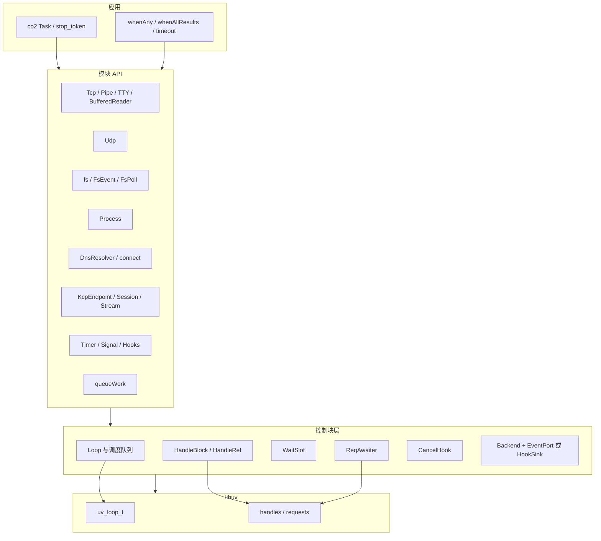

# uvco 架构设计

uvco 用 co2 的 C++14 无栈协程封装 libuv，在单个 loop 线程上提供可取消、以 `Result` 报告错误的异步 I/O。本文描述**当前**实现的目标、分层、核心机制与不变量。模块级 API 与语义见 [modules/](modules/README.md)，关键时序见 [sequences.md](sequences.md)，使用步骤见 [guide.md](guide.md)。实现过程中的偏差与审查记录见 [architecture-history.md](architecture-history.md)。

设计文档（已批准的专项方案，部分细节以本文与模块文档的现行契约为准）：

- [design-watchers.md](design-watchers.md) — 统一 watcher 内核
- [design-kcp.md](design-kcp.md) — 可选 KCP 适配层

## 1. 目标与非目标

### 目标

- 把 libuv 的句柄、请求与 loop 生命周期接到 co2 `Task` / `stop_token`，而不是再造一套运行时。
- 数据路径尽量把调用方的缓冲区直接交给 libuv（TCP/Pipe/UDP/fs 原始读写无用户态额外拷贝）；不可避免的拷贝写清楚（KCP、DNS 结果、拥有型字符串接口）。
- 错误走 `Result<T>`（libuv 负错误码）；用法错误是契约违规（`UVCO_CONTRACT_*`，沿用 co2 的进程级处理器），不抛业务异常。
- 取消可预测：已请求停止时通常立即 `Errc::canceled`，即使操作本可以立刻完成（“先停止”规则）；句柄 `close()` / Loop 析构中止操作为 `Errc::aborted`，与取消区分。
- 控制块与等待槽有明确所有权和界限：调度队列构造期预分配；watcher 投递策略编译期、有界。

### 非目标

- 不是多线程并行运行时，也不是跨线程的同步原语。`Event` / `Mutex` / `Channel` 只允许在 loop 线程使用。
- 不实现完整的 RFC 6724 / NAT64，也不宣称 Happy Eyeballs 完全符合 RFC 8305（仅核心子集）。
- 不提供严格的进程树 containment（POSIX 进程组是 best-effort；Windows Job 尚未实现）。
- KCP 不是默认依赖，不负责握手、认证、加密或 FIN；不保证在任意网络上相对 TCP 降低 30%–40% 延迟。
- 不承诺硬实时，也不把毫秒级定时精度写成契约。
- 不把 macOS / Windows / QNX 上的实机验证写成已经完成。

## 2. 分层

自上而下：

1. **应用与组合子**：用户写 `CO2_BEG` 协程，用 `run` / `drain` 驱动；`whenAny`、`whenAllResults`、`timeout` 组合已有 awaitable。
2. **模块 API**：只可移动的句柄与一次性请求 awaiter（或返回 `Task` 的高级助手）。
3. **控制块层**：`Loop`、`HandleBlock`、`WaitSlot`、`ReqAwaiter`、`CancelHook`，以及 watcher 的 Backend + 投递策略。这一层不把系统调用藏进算法核（KCP 的 `KcpCore` 尤其如此）。
4. **libuv**：`uv_loop_t`、原生句柄与请求。用户经 `Loop::raw()` 自行创建的句柄由 `~Loop` 兜底关闭。

## 3. 核心概念

### 3.1 Loop 与调度队列

`Loop` 持有一个 `uv_loop_t`，并实现 `co2::Scheduler`。用户持有 `Loop`（不可复制、不可移动）；`run(loop, task)` 只负责驱动，同一 loop 可多次 `run()`。

- 绑定构造它的线程（“loop 线程”），每个线程最多一个 `Loop`。`Loop::current()` 取当前线程的实例。
- `schedule()` 可在任意线程调用：loop 线程进入本地队列，由 `uv_idle` 在下一次迭代排空；其他线程进入互斥保护的远程队列，并 `uv_async_send` 唤醒。排空时先把队列整体换出再逐个 `resume`，避免在 libuv 回调里无限递归。
- 每条队列的容量在构造时预分配，默认 65536；溢出是契约违规，不会在 `noexcept` 的 schedule/drain 路径上隐式分配或丢续体。
- 内部 `uv_async` 默认 unref，不单独保活 `uv_run`。跨线程工作靠 `keepAlive_` 计数：`run()` 期间以及用户持有的 `Loop::KeepAlive` 会使 async 被 ref。把工作交给 loop 看不见的线程、之后再 `schedule()` / `post()` 回来的代码必须持有 `KeepAlive`，否则 `drain()` 可能在投递到达前返回；带着存活的 `KeepAlive` 析构 Loop 是契约违规。
- 首次构造时（每进程一次），若 `SIGPIPE` 仍为默认动作则忽略它，向已关闭的连接写入返回 `EPIPE` 而不是杀死进程；用户已设置的动作不变。

`run(loop, task, token = {})` 是 loop 版 `syncWait`：在 loop 线程、且没有另一个 `run()` 进行时启动 Task，`uv_run` 直到该 Task 完成，返回值或重抛异常。可选 `token` 成为整棵任务树的根 `stop_token`。若 Task 在别的线程完成，完成通知先经 `schedule()` 回到 loop 线程再停止 `uv_run`。`run()` **不**关闭用户句柄。

`drain(loop)` 运行直到没有活动句柄/请求、没有排队协程、没有存活的 `KeepAlive`。

### 3.2 Task、stop_token、CancelHook

协程是 co2 `Task`。uvco 不重新实现调度器或 Promise 类型。取消令牌沿 Task 等待链借用（co2 `0be5ab2` 起不再每次拷贝）。

`CancelHook` 把 `stop_callback`（可能在任意线程触发）投递到 loop 线程，再对仍在途的请求执行取消。停止不可能时立即返回；否则把回调 placement-new 到内联存储，不为 hook 再分配。内部 hook 必须是 `noexcept`。

`find_package(co2)` 不带数字版本（预览包会拒绝），但必须通过 `cmake/co2_capability.cpp`：包括 TaskAccess/FrameHeader 表面，以及**左值 co_await 就地等待**（要求 co2 `0be5ab2` 或更新）。FetchContent 锁定提交见 `UVCO_CO2_GIT_TAG`。

### 3.3 HandleBlock 与 HandleRef

`uv_close` 是异步的，C++ 析构无法等待。句柄对象（`Tcp`、`Timer`、`Udp`…）只持有指向堆上控制块的指针；`uv_handle_t::data` 一律存 `HandleBlock*`。

- 从构造成功起，控制块由 `HandleRef` 保活（普通计数，不是 `shared_ptr`，不是原子；句柄操作限 loop 线程）。
- 用户析构时若仍有挂起操作，是契约违规；否则发起 `uv_close`，控制块在 close 回调且无在途操作、所有者已释放后才释放。
- `close()` 返回指针大小的 `CloseAwaiter`，并**立即置空**所有者（之后 `isOpen()==false`）。等待直到 close 回调；未被等待的 awaiter 析构仍会发起关闭。
- 显式 `close()` 时若有挂起操作，以 `Errc::aborted` 中止它们（通常经 `loop.schedule` 延后恢复），这是合法的“取消一切”；只有直接析构未关闭且仍有挂起操作才算违规。
- 库可提前 `closeInternally()`（例如取消 connect）：所有者仍持有控制块，`isOpen()==true`，后续操作返回 `UV_EBADF`，`close()` 仍可等待。
- 句柄可以比 Loop 活得久：`~Loop` 关闭它并把控制块变为孤儿。孤儿句柄只能 `close()` / 析构（直接释放，不触碰 Loop）；其他操作是契约违规。

### 3.4 WaitSlot

`detail::WaitSlot<T>` 内联在控制块里，统一“单等待者预约 → 完成/中止 → `await_resume` 取走结果”。用于 Timer tick、stream read/accept、UDP recv、Process wait、KCP 收发等。它不改变 HandleRef、底层停止方式或 inline/deferred 恢复策略。槽位直到 `await_resume` 取走后才释放，包含已完成但尚未恢复的阶段。同一槽上并发第二个等待者是契约违规。

### 3.5 ReqAwaiter

`detail::ReqAwaiter<Derived, Req, T>` 是单次 libuv 请求（`uv_fs_t`、`uv_connect_t`、`uv_write_t`、`uv_getaddrinfo_t`、`uv_work_t`、以及 Sleep 所用的 `uv_timer_t` 等）的 CRTP 模板。

- 请求体是 awaiter 的成员；`req.data` 指向 awaiter。全部在 loop 线程完成，回调里 `complete` 后直接 `resume()`。
- Derived 提供 `start(uv_loop_t*)` 与 `finish(int)`；可选 `cancellable`、`respectStop` 与自定义 `cancel()`（默认 `uv_cancel`）。
- **右值**等待：awaiter 被移进 co2 的 await 槽，超过默认 64 字节内联容量时堆分配一次。
- **左值**等待（把 awaiter 写在 `CO2_BEG` 局部列表里）：co2 `0be5ab2` 起就地使用该对象，帧里只记指针，零额外分配，完成后可再次等待。这不再需要 uvco 自己的 `operator_co_await()` 包装。

流上的 `read` / 热路径 `write` 不是把巨大请求体放进 awaiter：`WriteAwaiter` 已缩到 64 字节以内，`try_write` 当场写完时热路径 0 次堆分配；未写完的部分才为原生 `uv_write` 分配请求。

### 3.6 Watcher：Backend、EventPort / HookSink、DeliveryPolicy

Timer、Signal、Idle/Prepare/Check、FsEvent、FsPoll 共用同一套内核，但**不抹平语义**。

- **Backend**：对原生 `uv_*_init/start/stop` 的薄封装。
- **EventPort**：协程通过 `next()` 拉取事件。
- **HookSink**：相位 hook 直接调用用户 `noexcept` 回调，不经过队列；`next()` 是高级观察适配。
- **DeliveryPolicy**（编译期、有界）：
  - Timer：累计到期次数（没人等待也不丢）。
  - Signal：按信号编号饱和计数（计的是 libuv 回调次数，不是 POSIX 发送次数）。
  - Hooks：只保留最新一次。
  - FsEvent / FsPoll：32 项 FIFO；FsEvent 对同一相对文件名合并事件位。

公共不变量：`start` 失败保留旧监视；成功的 `start` 开启新纪元，旧的 `next()` 租约不切换世代；`stop`/`close` 使挂起的 `next()` 以 `aborted` 结束。细节见 [design-watchers.md](design-watchers.md) 与 [modules/signal-hooks-tty.md](modules/signal-hooks-tty.md)、[modules/fs.md](modules/fs.md)。

## 4. 线程模型

| 操作 | 允许的线程 |
| --- | --- |
| 构造 / 析构 Loop，`run` / `drain`，几乎所有句柄与 sync 操作 | 仅 loop 线程 |
| `schedule()`、`CancelHook` 触发的投递、`KeepAlive` 析构 | 任意线程 |
| `queueWork` 的 callable、部分 fs/DNS 在 libuv 线程池中执行 | 线程池；完成回调回到 loop 线程 |
| `co2::scheduleOn(loop)` | 从其他调度器回到 loop 线程后再碰 libuv |

违反“仅 loop 线程”是契约违规。不要在工作线程上操作 `Event`/`Mutex`/`Channel` 或 libuv 句柄。

`queueWork`、fs、getaddrinfo 共享 libuv 全局线程池。不可取消的 NSS 查找可能拖延 Resolver/`~Loop` 的关闭，没有硬 deadline。

## 5. 生命周期与关闭顺序

`~Loop` 的顺序（借鉴 kotatsu 的 event_loop 析构）：

1. 对仍打开的 uvco 句柄 `loopClosing()` / `closeInternally()`，挂起操作以 `Errc::aborted` 结束；经 `raw()` 直接创建的外源句柄 `uv_close`。
2. `UV_RUN_ONCE` 直到 loop 不再存活：close 回调、被中止或取消的请求回调、因此恢复的协程都在这里运行（它们新开的句柄也会被关闭）。
3. 关闭内部 async / idle，`uv_loop_close` 必须成功。
4. 仍存活的控制块变为孤儿（见 §3.3）。

特殊规则：

- **Process**：析构把仍在运行的子进程交给后台 reap-only 控制块，**不**发信号。只有 `detach()` 把回收责任交给调用者。`~Loop` 会等待未 detach 的子进程退出，可能无限阻塞；需要时先 `kill` 再关闭。取消 `wait` 不杀子进程。
- **Sleep / yieldNextTurn**：在途期间登记为 LoopResident，析构走原关闭回调并以 `aborted` 完成。
- **写取消**：挂起中的 stream `write` 被 `stop_token` 取消时，**默认关闭整个流**，等原生回调后返回 `canceled`。`timeout(loop, d, stream.write(...))` 若超时，会取消 write，因而也会关流。
- 远程 `schedule`/`post` 的线程若既不在 `run()` 期间、也不持有 `KeepAlive`，与 `drain()` / `~Loop` 竞争；`~Loop` 发现未处理的远程工作即契约违规。

时序图见 [sequences.md](sequences.md)。

## 6. 错误模型

- `enum class Errc`：值即 libuv 负数错误码（`canceled`、`eof`、`timed_out`、`busy`…）。唯一例外是 uvco 自己的 `Errc::aborted`（`UVCO_EABORTED`，-30001）：操作因 `close()`/`stop()` 或 Loop 析构而结束，不是 `stop_token` 取消。
- `Result<T>` / `Result<void>`：`explicit operator bool` / `hasValue()` 表示成功；`value()` / `*` / `->` 在失败时是契约违规；`error()` 在成功时是契约违规；`errorCode()` 成功时为空，`message()` 走 `uv_strerror`（aborted 有单独文案）。可转换为 `std::error_code`，category 名为 `"uv"`。
- 资源构造失败（`bad_alloc`、`uv_*_init` 失败）通过 `create()` 工厂返回 `Result`，不抛给用户；对象构造函数在无法报告 `Result` 的场合仍可能契约检查失败（例如每线程已有 Loop）。
- 用户 callable 或结果移动/构造抛出的 C++ 异常：在请求完成后于 loop 线程重抛（Work、whenAny/whenAllResults、DNS 投影等）。组合子会先取消并等待已启动的兄弟分支，再重抛。

## 7. 取消模型

统一的“先停止”规则：`stop_token` 在挂起前已被请求，则通常立即 `Errc::canceled`，即使操作可以同步完成。

| 场景 | 结果 |
| --- | --- |
| 用户 `request_stop()`，请求尚未完成 | `Errc::canceled` |
| `close()` / `stop()` / `~Loop` 中止挂起操作 | `Errc::aborted` |
| `timeout` 先等到时 | `Errc::timed_out`（主操作被请求停止并被等待结束） |
| 父取消 `timeout` / `whenAny` | `Errc::canceled`，不是超时 |
| 取消挂起的 stream `write` | 关闭整个流，返回 `canceled` |
| 取消 `Process::wait` | 不杀子进程 |
| `queueWork`：仍在队列中 | `uv_cancel` 成功则 fn 不运行，返回 `canceled` |
| `queueWork`：fn 已在跑或已算完 | 不强制中断；晚到取消**返回计算结果**，不丢弃副作用 |
| 忽略取消且永不结束的分支 / Work | 整个组合子或 `drain` 会一直等 |

`whenAny` / `whenAllResults` 的交付优先级：异常 > 首个业务错误 > 取消。所有已启动分支结束后才把结果或异常交给等待者。

## 8. 内存与分配模型

依据 [perf-review.md](perf-review.md) 的现行测量（loopback，不能外推到所有负载）：

- 协程帧：每个 Task 通常一次堆分配；同一 Task 里循环 await 不重新分配帧。
- 默认 await 槽 64 字节。热路径 `WriteAwaiter` 已放入槽内，右值 `try_write` 成功时 0 次分配。帧局部左值 `ReqAwaiter`（如 `fs::StatOp`、`Sleep`）由 co2 就地等待，0 次额外分配。超过 64 字节的**右值**大请求会装箱一次。
- 每个句柄一个堆上 `HandleBlock`，不是每次 read 新建。
- 调度队列、WaitSlot、CancelHook 内联存储均避免在热路径隐式 new。
- `BufferedReader` 与 process capture 把数据直接读进 `string` 尾部，异常或取消时回滚。
- Work 的取消状态懒创建：构造时不分配；不带 token 的 callable 不创建内部 `stop_source`。
- KCP：ikcp 内部拷贝；`output` 回调中的缓冲区是借用的，必须拷进有界发送队列后才能异步发出。

## 9. 构建、安装与可选组件

| 项 | 说明 |
| --- | --- |
| 语言 | C++14；已测 g++ 13、clang++ 18 |
| CMake | ≥ 3.14（presets 需 ≥ 3.21） |
| libuv | ≥ 1.40：`find_package` → pkg-config → FetchContent `v1.48.0` |
| co2 | `find_package(co2 CONFIG)`（无版本号）或 FetchContent，锁定 `0be5ab2f1b72be3755d8d13fb02d4bf32f652539`，并通过就地左值能力探测 |
| 默认目标 | `uvco::uvco`（INTERFACE） |
| `UVCO_ENABLE_KCP` | 默认 OFF；开启后提供静态库 `uvco::kcp`（vendor ikcp 原样嵌入，C 适配 TU 把 `IOFFSETOF` 换成 `offsetof`） |
| `UVCO_BUILD_TESTS` | 顶层工程默认 ON，包含测试与使用手册示例 |
| `UVCO_ENABLE_INSTALL` | 顶层默认 ON；依赖不捆绑进安装前缀，消费者自行提供 co2/libuv 并再跑探测 |
|  sanitizers | 本地与 CI 要求 ASan+UBSan、TSan 全绿；KCP 无 sanitizer 豁免 |

安装后 `find_package(uvco CONFIG)` 得到 `uvco::uvco`，KCP 组件为 `uvco::kcp`（需本库安装时已开启）。完整命令与消费者示例见 [guide.md](guide.md)。

## 10. 模块地图

| 模块 | 文档 |
| --- | --- |
| Loop / Result / 句柄 / 取消 / yield | [modules/core.md](modules/core.md) |
| Timer / Sleep | [modules/timer.md](modules/timer.md) |
| Event / Mutex / Channel | [modules/sync.md](modules/sync.md) |
| whenAny / whenAllResults / timeout | [modules/combinators.md](modules/combinators.md) |
| Tcp / Pipe / Stream / BufferedReader | [modules/stream.md](modules/stream.md) |
| Udp | [modules/udp.md](modules/udp.md) |
| DNS 缓存与 Happy Eyeballs | [modules/dns.md](modules/dns.md) |
| 文件系统与 FsEvent / FsPoll | [modules/fs.md](modules/fs.md) |
| Process / capture | [modules/process.md](modules/process.md) |
| Signal / phase hooks / TTY | [modules/signal-hooks-tty.md](modules/signal-hooks-tty.md) |
| queueWork | [modules/work.md](modules/work.md) |
| KCP（可选） | [modules/kcp.md](modules/kcp.md) |

## 附录 A. 仍开放的边界

- Windows Job kill-tree；完整 RFC 6724 / NAT64；精确 TTY ModeGuard / 快照租约。
- 通用 fd poll、Pipe IPC（传递句柄）与 Linux 抽象套接字（`uv_pipe_bind2` 需要 libuv ≥ 1.46，而下限是 1.40）。
- 不能在不关闭流的情况下取消写；connect 取消会关闭流。
- 非可取消的 NSS 查找可能拖延 Resolver / Loop 关闭。
- whenAny 只提取胜者、丢弃其余成功值：尚未批准。
- KCP：vendor 部分 OOM 不可恢复；TX 串行；无握手/认证/FIN；弱网相对 TCP 的优势尚未在同条件对照中验证。
- macOS / Windows / QNX 原生路径仍需目标环境验证。QNX 上 `fs_event` 为 `ENOSYS`，见 [qnx.md](qnx.md)。
- 继续依赖 co2 的若干 `detail` 接口，靠能力探测守门，尚未变成上游稳定扩展点。
