# uvco 关键时序

下列图描述现行实现的控制流，而不是抽象愿望。参与者名称与源码中的类型对应。模块语义见 [modules/](modules/README.md)，关闭与取消不变量见 [architecture.md](architecture.md)。

## 1. 左值 ReqAwaiter：fs::stat

帧局部 `StatOp` 就地等待：co2 只在 await 槽里存指针，请求体留在协程帧中。

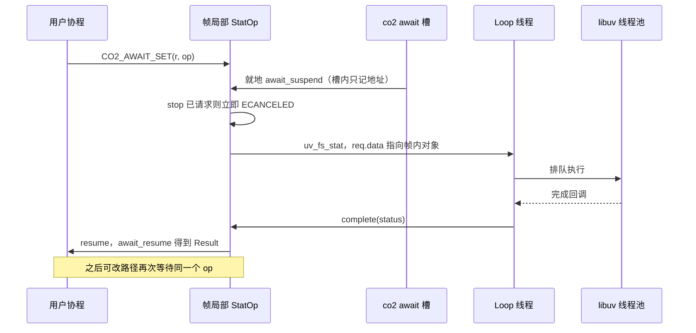

右值 `CO2_AWAIT(fs::stat(loop, path))` 会把约 440 字节的 awaiter 移进槽，超出 64 字节时多一次堆分配；回调里的 `this` 是槽里那份副本，不是帧局部对象。

## 2. 热路径 write（try_write 成功）

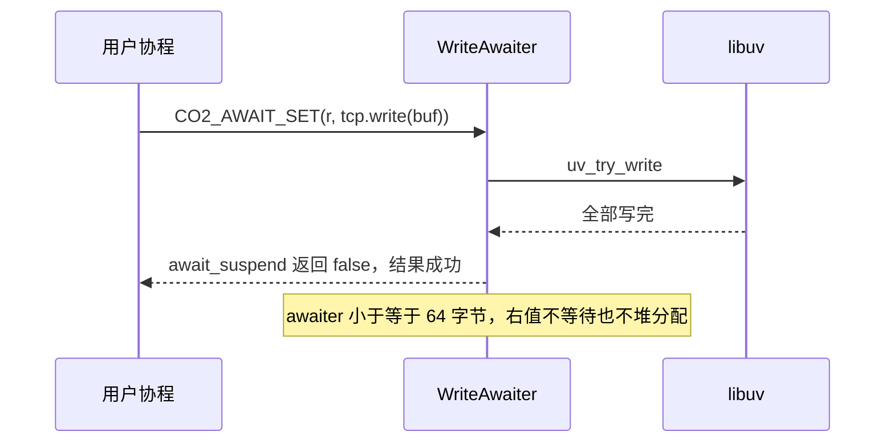

未写完的部分会分配原生 `uv_write` 请求，并在请求上挂 `CancelHook`。

## 3. stop_token 取消在途请求

以可取消的 fs 请求为例（`uv_cancel` 有效）。任意线程都可能 `request_stop`。

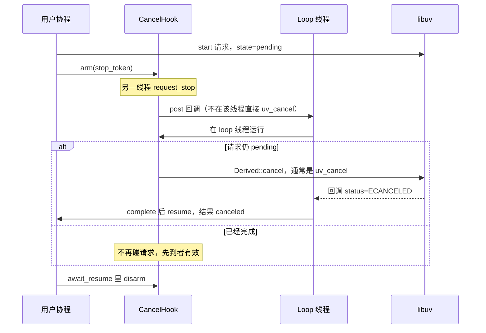

已请求停止且尚未 start 时，ReqAwaiter 不发起请求，`await_suspend` 返回 false，结果 `canceled`。

## 4. timeout(write) 关闭流

`timeout(loop, d, tcp.write(buf))` 在计时器先到时取消 write；按现行契约，取消挂起的 write 会关闭整个流。

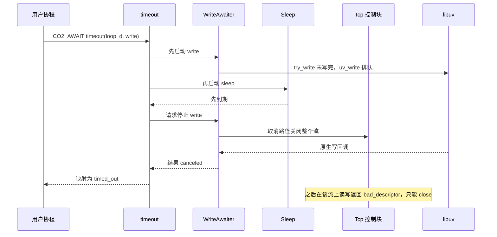

若 write 在睡眠前就完成，计时器不会启动，结果是写成功，流保持打开。

## 5. Loop 析构与关闭顺序

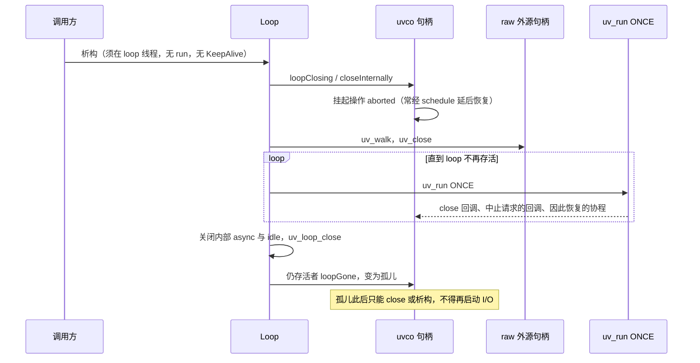

未 detach 的 `Process` 会使这一阶段一直等到子进程退出。

## 6. Process：spawn、wait、析构回收

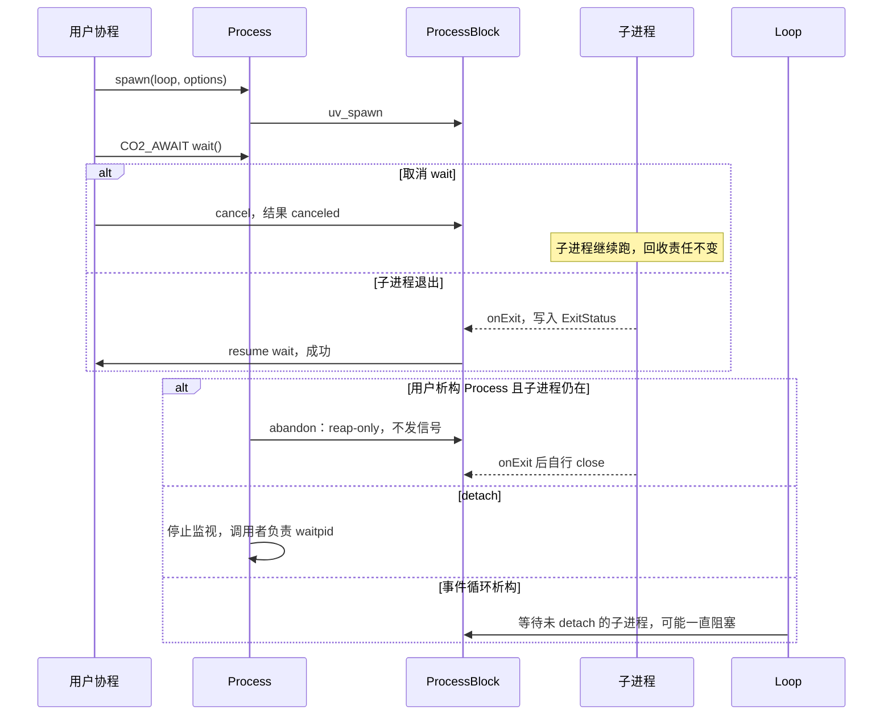

## 7. Happy Eyeballs connect

核心子集：解析后按族交错、有节奏地并发有限个 `Tcp::connect`，不是完整 RFC 6724。

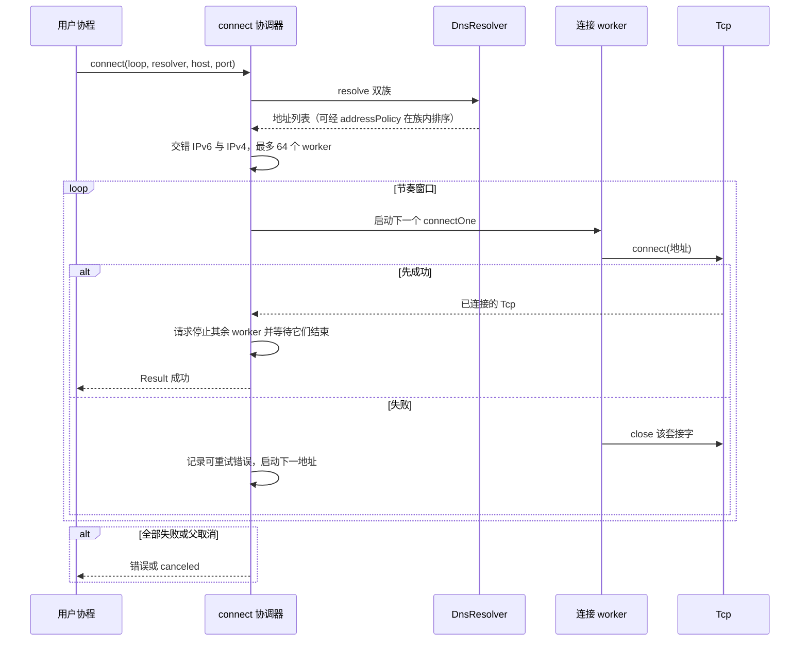

## 8. Watcher 事件投递（next）

以 FsPoll / Signal / Timer 这类 EventPort 为例。HookSink（`onPrepare` 等）不经队列，直接调用 `noexcept` 回调。

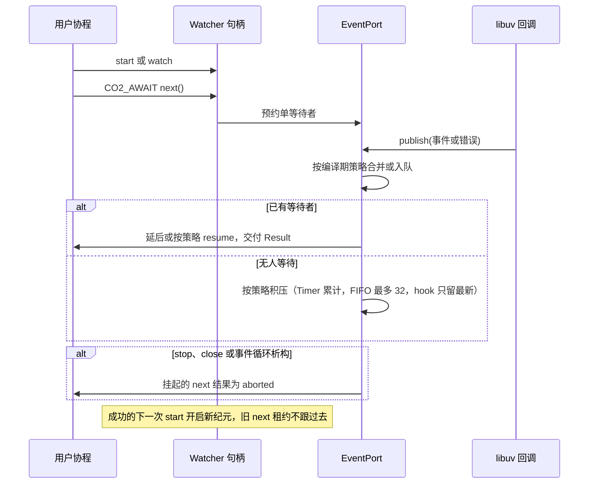

## 9. Work 晚到取消仍返回计算结果

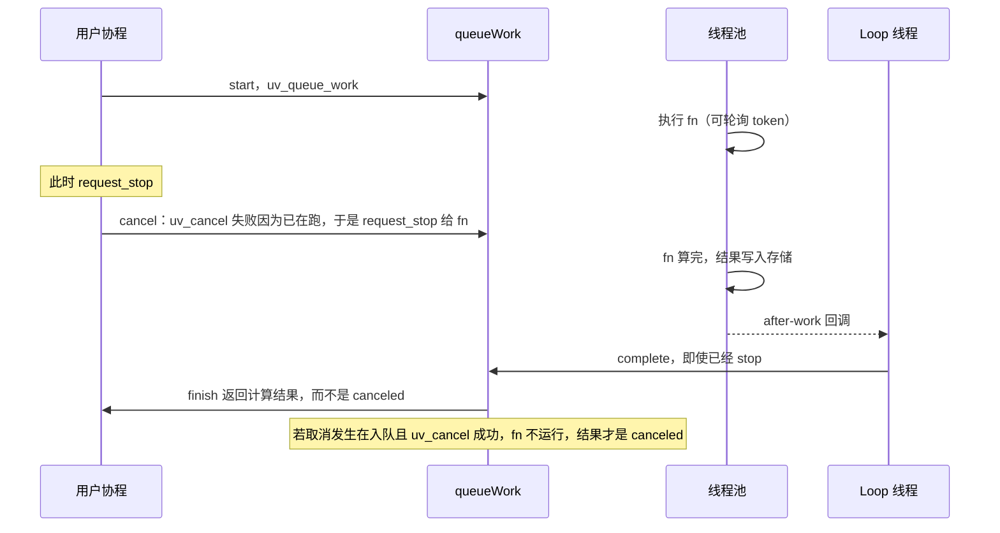

## 10. KCP：发送、收包、update 与 check 定时器

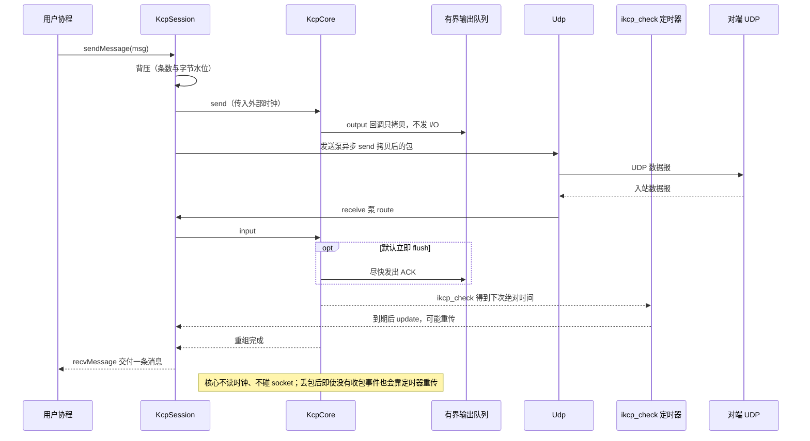

## 11. acceptPeer 接入未知 conv

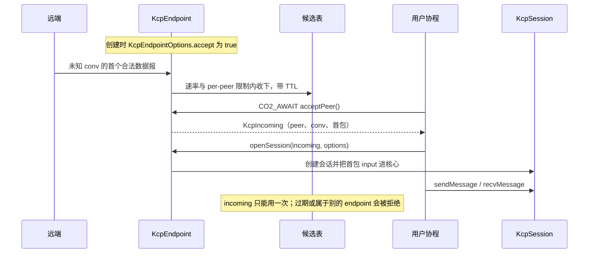
